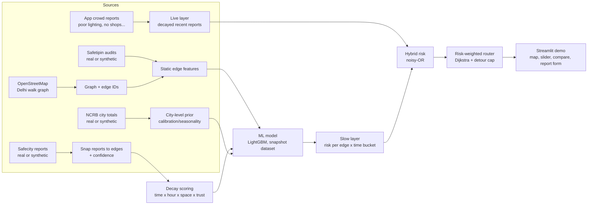

# Time-Aware Safe Route Scoring for Women — Delhi Prototype

> **Read this first (for the AI coding agent, e.g. Antigravity).**
> This file is the single source of truth for the project. Build in the order given in
> [Section 14](#14-build-plan-for-the-coding-agent). Every stage must run end-to-end before the next starts.
> **Non-negotiable rules are in [Section 2](#2-non-negotiable-rules).**

---

## Table of contents
1. [Project in one page](#1-project-in-one-page)
2. [Non-negotiable rules](#2-non-negotiable-rules)
3. [Scope and tiers](#3-scope-and-tiers)
4. [System architecture](#4-system-architecture)
5. [Study area (Delhi) and street network](#5-study-area-delhi-and-street-network)
6. [Data: sources, schemas, adapters](#6-data-sources-schemas-adapters)
7. [Algorithm 1 — Snapping reports to street segments](#7-algorithm-1--snapping-reports-to-street-segments)
8. [Algorithm 2 — Time-decayed, hour-aware report scoring (core idea)](#8-algorithm-2--time-decayed-hour-aware-report-scoring-core-idea)
9. [Algorithm 3 — ML risk model](#9-algorithm-3--ml-risk-model)
10. [Algorithm 4 — Hybrid risk and risk-aware routing](#10-algorithm-4--hybrid-risk-and-risk-aware-routing)
11. [Evaluation plan](#11-evaluation-plan)
12. [Demo application (what the audience sees)](#12-demo-application-what-the-audience-sees)
13. [Repository structure and tech stack](#13-repository-structure-and-tech-stack)
14. [Build plan for the coding agent](#14-build-plan-for-the-coding-agent)
15. [Ethics, privacy, limitations](#15-ethics-privacy-limitations)
16. [Novelty and patent note (honest version)](#16-novelty-and-patent-note-honest-version)
17. [Explaining this to faculty](#17-explaining-this-to-faculty)
18. [Glossary](#18-glossary)

---

## 1. Project in one page

**Problem.** Navigation apps give the *fastest* route. Safety apps often give *static* "safe route" maps.
But the risk on a street changes with the **time of day** (a market is fine at 2 pm and uncomfortable at
11 pm), and conditions change **quickly** (a streetlight fails, a shop shuts, an incident happens).
A map built once goes stale.

**Idea.** Score every street segment of a real slice of Delhi for a *given time*, by combining:

1. **Slow layer (machine learning):** a model trained on historical incident reports + street features
   (lighting, isolation, shops, police, metro, liquor outlets...) that predicts how likely a segment is to
   have reported incidents in a given time bucket.
2. **Fast layer (time-decayed crowd reports):** recent user reports (poor lighting, harassment, no shops
   open) that count a lot right now, fade over time at a rate that depends on the report type, and only
   matter when the *hour of day* is similar to when the report was made.
3. **Risk-aware routing:** a shortest-path search where each segment's cost is
   `length × (1 + α × risk)`, with a "safer ↔ faster" slider and a cap on detour length.

**Study area.** One real fragment of Delhi (default: **Dwarka**, alternative: **Hauz Khas–Saket**),
using the real OpenStreetMap street graph — not a generic map.

**Current data status (be honest about this everywhere).**
Data has been **requested** from Safecity (Red Dot Foundation), Safetipin and NCRB. Until it arrives, the
prototype runs on a **synthetic data generator** (`generate_synthetic_safety_data.py`) whose output is
stamped `data_origin = SYNTHETIC`. The pipeline is built so real data can be dropped in through adapters.

**Deliverables.**
- A reproducible pipeline: graph → features → snapping → decay scoring → ML → routing.
- A web demo (Streamlit) with a time-of-day slider, risk map, fastest-vs-safest route comparison,
  live report submission and a "decay playground".
- An evaluation report with baselines, a time-based split and a synthetic-recovery experiment.
- This document, usable as the project brief for viva/faculty review.

---

## 2. Non-negotiable rules

These apply to every file the coding agent writes.

1. **Never present synthetic data or results as real.** Keep `data_origin` on every dataframe; the app must show a visible
   banner *"Demo running on SYNTHETIC data"* whenever any synthetic source is loaded.
2. **No label leakage.** Columns starting with `_truth_` and the file `ground_truth_edge_risk.csv` are for
   *evaluation only*. They must never appear in model features, snapping logic or the live layer.
3. **Time-based validation only.** No random train/test splits on time-stamped reports.
   Features at snapshot date `T` may use only reports with `timestamp < T`.
4. **Compute distances in a projected CRS** (metres, e.g. the UTM zone returned by `ox.project_graph`), not in
   raw lat/lon.
5. **Reproducibility.** One `seed` in `configs/config.yaml`; pin versions in `requirements.txt`; every script is
   runnable from the command line with `--help`.
6. **Do not claim the model predicts real-world harm.** On synthetic data it shows the pipeline works.
   On real data the target is *reported-incident risk*, which is biased (see [Section 15](#15-ethics-privacy-limitations)).
7. **Privacy.** No user trails stored. Reports are stored with coordinates snapped/rounded; reporter IDs are hashed.
8. **Fail soft in the demo.** If OSM download fails, load the cached `graph.graphml`. The app must run with no
   internet after the first setup.
9. **Never label a neighbourhood "dangerous".** Use "higher reported risk at this time", with a colour scale and the
   uncertainty note.

---

## 3. Scope and tiers

Because of the demo deadline, build in tiers. Each tier ends in something runnable and demonstrable.

| Tier | Goal | Must have | Done when |
|---|---|---|---|
| **0 — Demo core** | Show the idea working on a real Delhi street graph | OSM graph, synthetic data, static features, decay scoring, hybrid risk, routing, Streamlit map with time slider | User picks two points; app shows fastest vs safest route with risk numbers |
| **1 — ML + evaluation** | Show it is more than a formula | Snapshot dataset, LightGBM, 3 baselines, time-split metrics, calibration, feature importance | Results table + plots in `reports/` and an "Evaluation" tab |
| **2 — Realism** | Trust and robustness | Spam/trust weighting, empirical-Bayes smoothing, SHAP explanations, route "why" panel, synthetic-recovery experiment | Spam test passes; recovery Spearman reported |
| **3 — Future (do not build now)** | Real data + research upgrades | Adapters for real Safecity/Safetipin, graph neural net, time-dependent routing, mobile app | Listed in "Future work" only |

---

## 4. System architecture



**Two layers, two speeds** (explain this to faculty):

| Layer | Updated | Input | Output |
|---|---|---|---|
| Slow (ML) | Retrained periodically (weekly/monthly) | Historical reports + static street features | `p_ml(edge, time-bucket)` |
| Fast (decay) | Evaluated at query time | Recent crowd reports | `S_live(edge, now)` |

---

## 5. Study area (Delhi) and street network

- **Candidate areas (approximate bounding boxes, verify on a map):**
  - Dwarka: N 28.610, S 28.570, E 77.060, W 77.020 (≈ 4.4 × 3.9 km ≈ 17 km²)
  - Hauz Khas–Saket: N 28.560, S 28.530, E 77.220, W 77.180 (≈ 3.3 × 3.9 km ≈ 13 km²)
- If the model or app is slow, shrink the box to about 3 × 3 km. Choose the area where real incident data is
  available once it arrives; the code must work for any bbox.
- **Graph:** OSMnx pedestrian network (`network_type="walk"`), downloaded once and cached to `graph.graphml`.
  - OSMnx API changed in v2: `ox.graph_from_bbox(bbox=(left, bottom, right, top), ...)`. In v1 the signature is
    `(north, south, east, west)`. Handle both (the generator script already does).
  - OSMnx drops many tags by default. To keep lighting information, add `lit` before downloading:
    `ox.settings.useful_tags_way += ["lit"]`.
- **Edge ID.** Make the graph undirected for risk purposes: risk is stored per *undirected segment*
  `edge_id`, then mapped back to both directed edges for routing.
- **Optional graph clean-up:** merge very short edges (< 15 m) or use `ox.simplify_graph` (default) so that one
  "segment" is a meaningful stretch of street.
- **Real POIs to replace the random placeholders** (query via `ox.features_from_bbox`):
  metro stations (`railway=station`+`station=subway`), police (`amenity=police`), liquor shops
  (`shop=alcohol`), markets/shops (`shop=*`), bars/pubs (`amenity=bar|pub`), hospitals, ATMs, bus stops.

---

## 6. Data: sources, schemas, adapters

### 6.1 Sources and status
| Source | Provides | Status | Granularity caveat |
|---|---|---|---|
| **Safecity** (Red Dot Foundation) | Crowdsourced harassment reports with location, category, time of day / day of week | Access **requested** (no public API found) | Location can be approximate; self-reported |
| **Safetipin** | Safety audits (lighting, openness, etc.) at points | Access **requested** | Audit points, not full coverage |
| **NCRB** | Annual "Crime in India" statistics | Public tables (verify format) | City-level, not geocoded: use only as a prior/calibration |
| **OpenStreetMap** | Street network and POIs | Public | Tag completeness varies |
| **App crowd reports** | Short-lived signals from our own form | Synthetic now; live later | Needs trust weighting |

### 6.2 Synthetic data (current)
Run: `python generate_synthetic_safety_data.py --area dwarka --n-reports 6000` → `synthetic_data/`.
The generator builds a hidden "true" risk surface (unlit + isolated + liquor outlets − police − open shops,
with separate night / evening / daytime peaks on a 24-hour circular clock), then samples noisy, biased reports
from it. It adds: reporting bias (busy areas over-report), location noise (30% rough), spam accounts and a
mild Friday/Saturday-night effect.

### 6.3 Canonical schemas (the pipeline reads ONLY these)
**`reports` (Safecity-style)**
| column | type | meaning |
|---|---|---|
| report_id | str | unique ID |
| data_origin | str | `SYNTHETIC` or `REAL_SAFECITY` |
| timestamp | datetime | when the incident happened |
| latitude, longitude | float | reported location |
| category | str | e.g. Commenting, Stalking / Following, Touching / Groping |
| severity | int 1–5 | mapped from category |
| location_confidence | str | `high` / `low` |
| reporter_id | str | hashed user/account ID |
| `_truth_*` | — | **synthetic only; never use as features** |

**`audits` (Safetipin-style):** `audit_id, timestamp, latitude, longitude, lighting, openness, visibility,
people, security, walk_path, public_transport, gender_diversity, feeling, safety_score (0–3 scale), time_of_day`.
*(Column names are inspired by Safetipin's parameters, not guaranteed identical to the real export.)*

**`ncrb` (city-level):** `city, year, crime_head, section, cases_reported`.
*(Synthetic magnitudes are placeholders, not statistics.)*

**`microreports` (our app):** `report_id, timestamp, latitude, longitude, report_type, reporter_id` with
`report_type ∈ {poor_lighting, no_shops_open, harassment_incident, feels_unsafe, well_lit_and_busy}`.

**`edges_features`:** `edge_id, u, v, mid_lat, mid_lon, length_m, highway, lit, dist_metro_m, dist_police_m,
activity, isolated, shops_open_night, liquor_near, police_near, footfall_day, footfall_night`.
Note: `activity`, `isolated`, `shops_open_night` and the footfall columns are *proxies computed in the
generator*. With real OSM data, recompute them from real POIs and building density. Do **not** use
`report_propensity` as a model feature (it is part of the synthetic bias mechanism).

### 6.4 Adapters (when real data arrives)
Write `src/data/adapters.py` with one function per source: `load_safecity(path) -> reports`,
`load_safetipin(path) -> audits`, `load_ncrb(path) -> ncrb`. Each must (a) rename columns to the canonical
schema, (b) map the source's categories to our `category`/`severity` table, (c) drop rows without usable
location or time, (d) set `data_origin`, (e) hash reporter IDs, (f) log how many rows were dropped and why.
Everything downstream stays unchanged.

---

## 7. Algorithm 1 — Snapping reports to street segments

**Goal:** assign each report to a street segment (and neighbours) with a confidence.

1. Project the graph and the report points to the same metric CRS.
2. `ox.distance.nearest_edges(G_proj, X, Y, return_dist=True)` → nearest edge and distance `d`.
3. **Confidence rule:** `d ≤ 30 m` → high; `30–150 m` → low; `> 150 m` → discard (log count).
   Combine with `location_confidence`: low-confidence reports are spread over more neighbours.
4. **Spatial spreading (network kernel):** from the snapped edge, run Dijkstra on the segment graph with a cutoff
   (e.g. 250 m) and weight neighbours by a Gaussian of **network distance**, not straight-line distance
   (`K(d) = exp(−½ (d/σ)²)`, `σ ≈ 80–120 m`; use larger `σ` for low-confidence points).
5. Store a long table `report_edge_weights(report_id, edge_id, spatial_weight)`.

Why network distance? A report on one side of a railway line or park wall should not affect a street that is
close on the map but far by foot.

---

## 8. Algorithm 2 — Time-decayed, hour-aware report scoring (core idea)

For a report `i` (type `k`, severity `s_i`, reporter trust `τ_i`, report time `t_i`, report hour `h_i`),
the contribution to segment `e` at query time `t` (hour `h`) is:

```
w_i(e, t) = s_i · τ_i · exp(−λ_k · age_days) · HourKernel(h, h_i; κ_k) · K(d_net(i, e))

age_days   = (t − t_i) in days
λ_k        = ln(2) / half_life_k
HourKernel = exp( κ · ( cos(2π (h − h_i) / 24) − 1 ) )     # circular, wraps at midnight, peak = 1
K(d)       = exp( −½ (d / σ)² )                            # spatial spread along the street network

S_live(e, t) = 1 − exp( − Σ_i w_i(e, t) / c )              # saturates in [0, 1) so 50 reports ≠ 50× risk
```

### 8.1 Per-type parameters (starting values — tune, document, and show a sensitivity analysis)
| report type | half-life | κ (hour sharpness) | sign | rationale |
|---|---|---|---|---|
| harassment incident / category reports | 30–60 days | 2.0 | + | Patterns persist for weeks; matters most near the same hour |
| poor_lighting | ~14 days | 2.5 | + | Infrastructure faults persist until fixed; only matters after dark |
| no_shops_open | ~2 days | 3.0 | + | Very short-lived; tied to hour and day |
| feels_unsafe | ~10 days | 2.0 | + | Subjective, moderate persistence |
| well_lit_and_busy | ~7 days | 2.5 | − (protective) | Lowers risk; needs a floor so risk never goes negative |

`κ = 2` means the kernel is ≈ 0.14 at 12 hours' difference and ≈ 0.6 at ±3 hours: a 9 pm report affects 8–11 pm,
and barely 2 pm. Circular distance matters: 23:30 and 00:30 are one hour apart, not 23.

### 8.2 Worked example (use in the viva)
A harassment report at 21:00, 30 days ago (half-life 45 d → λ = 0.0154/day), severity 3, trust 1, on the same
segment (K = 1):
- Query **22:00 today:** decay = e^(−0.0154·30) = 0.63; hour kernel = exp(2(cos(2π/24) − 1)) = 0.87 → w ≈ 3 × 0.63 × 0.87 ≈ **1.64**
- Query **14:00 today:** hour kernel = exp(2(cos(2π·7/24) − 1)) ≈ 0.10 → w ≈ 3 × 0.63 × 0.10 ≈ **0.19**

Same report, same street, very different influence → the "last month at 9 pm does not affect 2 pm" behaviour.

### 8.3 Trust weighting (τ)
- **Corroboration:** boost if ≥ 2 independent reporters report within 100 m and ±3 h.
- **Burst/spam penalty:** if one account files `n` reports on the same segment within 72 h, scale each by `1/√n`.
- **Reporter reliability:** exponentially-smoothed fraction of the reporter's past reports that were corroborated.
- **Validation:** the synthetic data contains `_truth_is_spam`. Report precision/recall of the spam detector on it
  (evaluation only, never as an input).

### 8.4 Reference implementation (guide for the agent)
```python
import numpy as np

HALF_LIFE_DAYS = {"harassment": 45, "poor_lighting": 14, "no_shops_open": 2,
                  "feels_unsafe": 10, "well_lit_and_busy": 7}
KAPPA = {"harassment": 2.0, "poor_lighting": 2.5, "no_shops_open": 3.0,
         "feels_unsafe": 2.0, "well_lit_and_busy": 2.5}

def hour_kernel(query_hour, report_hour, kappa):
    return np.exp(kappa * (np.cos(2 * np.pi * (query_hour - report_hour) / 24.0) - 1.0))

def report_weight(sev, trust, age_days, q_hour, r_hour, rtype, spatial_w):
    lam = np.log(2) / HALF_LIFE_DAYS[rtype]
    return sev * trust * np.exp(-lam * age_days) * hour_kernel(q_hour, r_hour, KAPPA[rtype]) * spatial_w

def segment_score(weights, c=3.0):
    return 1.0 - np.exp(-np.sum(weights) / c)   # use signed weights for protective reports, then clip at 0
```
Vectorise with numpy/pandas (group by `edge_id`); never loop over segments in Python for the app's live layer.

---

## 9. Algorithm 3 — ML risk model

### 9.1 Task definition
> *Given a street segment, a time bucket and an as-of date, predict the probability that at least one
> (non-spam) incident is reported on that segment in that time bucket during the next `H` days.*

- **Time buckets:** 6 four-hour buckets (`00–04, 04–08, 08–12, 12–16, 16–20, 20–24`) × day type
  (weekday/weekend) = 12 combinations.
- **Snapshot (rolling-origin) dataset.** Choose snapshot dates `T` every ~14 days. For each `T`, each edge, each
  bucket:
  - **Features** use only information with `timestamp < T`.
  - **Label** `y = 1` if ≥ 1 non-spam report falls on the edge (or within 100 m network distance, to reduce
    sparsity) in that bucket during `[T, T + H)`, with `H = 30` days.
- Dataset size: `edges × 12 × snapshots` can reach millions. Use monthly snapshots, a smaller bbox, or keep all
  positives and subsample negatives (then re-calibrate).

### 9.2 Features
| group | examples |
|---|---|
| Static street | `highway` (one-hot/ordinal), `lit`, `length_m`, `dist_metro_m`, `dist_police_m`, `isolated`, `shops_open_night`, `liquor_near`, building density, degree/betweenness of the segment |
| Audit-derived | Mean Safetipin-style scores of audits within 150 m (separately for day and night) |
| Temporal | `bucket_id`, `hour_sin`, `hour_cos`, `is_weekend`, month |
| Historical counts | Raw counts in the last 30/90/365 days (all hours and same-bucket) |
| **Decay features (core idea)** | `S_decay_harassment`, `S_decay_lighting`, … evaluated at the bucket's mid-hour as of `T` |
| Neighbourhood | Mean/max of the above over adjacent segments (1-hop and 2-hop) |
| City prior | NCRB-style yearly trend/seasonality (a scalar per snapshot) |

**Do not include:** `_truth_*`, `report_propensity`, anything computed from reports at or after `T`.

### 9.3 Models (train all four so the story is honest)
| # | Model | Purpose |
|---|---|---|
| B1 | **Historical count** — rank segments by raw past report count | Simplest baseline |
| B2 | **Decay formula only** — rank by `S_decay` | Shows what the formula alone gives |
| B3 | **Static features only** (LightGBM, no report features) | Shows what works with zero reports (cold start) |
| M | **LightGBM, all features** (binary logistic; optionally Poisson on counts) | The ML model |
| (opt.) | **Empirical-Bayes Poisson-Gamma smoother** | Shrinks sparse segments toward their neighbourhood/type average: `rate = (Σcounts + α₀) / (exposure + β₀)` |

Why gradient-boosted trees rather than a deep network? Tabular data of moderate size, mixed feature types,
fast to train, interpretable (SHAP), strong on small data. A graph neural network is a possible future upgrade
once there is substantially more real data.

**Calibration:** apply isotonic regression (or Platt scaling) on a validation block so predicted values behave like
probabilities. Report a reliability curve and Brier score.

**Explainability:** SHAP values per prediction → "this segment is high-risk at 11 pm mainly because: unlit,
isolated, 2 recent reports".

### 9.4 Output of the slow layer
`risk_table.parquet`: `edge_id × bucket_id → p_ml` (and the percentile rank of `p_ml` within each bucket for
colouring). The app reads this file; no model inference in the request path.

---

## 10. Algorithm 4 — Hybrid risk and risk-aware routing

### 10.1 Hybrid risk at query time
Let `p̃` = percentile-scaled `p_ml(edge, bucket(t))` in [0, 1] and `S_live(edge, t)` the fast layer:

```
R(e, t) = 1 − (1 − p̃) · (1 − β · S_live)        # "noisy-OR": either layer can raise the risk; stays in [0, 1]
```
`β ∈ [0, 1]` (default 0.6) controls how strongly fresh reports can override the model. Protective reports reduce
`S_live` via a floor (never below 0).

### 10.2 Edge cost and route search
```
cost(e) = length_m(e) · (1 + α · R(e, t))        # α ≥ 0, the "safer ↔ faster" slider (0 = pure shortest)
```
- Algorithm: **Dijkstra** (or A* with the straight-line distance heuristic, which stays admissible since
  `cost ≥ length`). Complexity `O(E log V)`: fast for a few thousand edges.
- **Detour cap:** compute the shortest route length `L₀`. Evaluate several `α` values (`0, 0.5, 1, 2, 3, 5, 8`),
  keep only routes with `length ≤ (1 + max_detour) · L₀` (default `max_detour = 0.25`), and return the one with the
  lowest exposure. Also return 2–3 alternatives (`nx.shortest_simple_paths` on `cost`, Yen's algorithm).
- **Walking time:** `length / 1.25 m/s` (≈ 4.5 km/h) unless the user changes it.
- **Departure-time snapshot:** risk is evaluated at the departure time (state this as a limitation; time-dependent
  routing is future work).

### 10.3 Route metrics shown to the user
- Distance, walking time, **detour %** vs fastest.
- **Mean exposure** `Σ length·R / Σ length`.
- **Worst stretch:** maximum average risk over any 200 m window (a route with one terrible stretch must not hide
  behind a good average).
- **High-risk metres:** length where `R` is above the 80th-percentile threshold.
- **Risk reduction %** vs the fastest route.

### 10.4 Reference snippets
```python
import networkx as nx, numpy as np

def add_costs(G, risk_by_edge_id, alpha):
    # G: undirected-risk graph where each edge carries 'edge_id' and 'length'
    for u, v, k, d in G.edges(keys=True, data=True):
        r = risk_by_edge_id.get(d["edge_id"], 0.0)
        d["cost"] = d["length"] * (1.0 + alpha * r)

def safest_route(G, o, d, risk, alphas=(0, .5, 1, 2, 3, 5, 8), max_detour=0.25):
    base = nx.shortest_path(G, o, d, weight="length")
    L0 = path_length(G, base)
    best = (base, exposure(G, base, risk))
    for a in alphas[1:]:
        add_costs(G, risk, a)
        p = nx.shortest_path(G, o, d, weight="cost")
        if path_length(G, p) <= (1 + max_detour) * L0:
            e = exposure(G, p, risk)
            if e < best[1]:
                best = (p, e)
    return base, best[0]
```
(`path_length` and `exposure` are small helpers the agent should write; for a `MultiDiGraph` pick the minimum-cost
parallel edge.)

---

## 11. Evaluation plan

### 11.1 Protocol
- **Time-based split:** e.g. train on snapshots in months 1–16, validate 17–20, **test 21–24**. Never shuffle.
- **Metrics (test period):** PR-AUC (main, because positives are rare), ROC-AUC, Brier score, calibration curve,
  **Recall@top-k%** (what fraction of future reports fall in the top 10% riskiest segment-buckets), and
  **lift over B1**.
- **Report a table:** B1, B2, B3, M (and the Bayes smoother). If ML does not beat the decay formula, say so.
- **Ablations:** remove the hour kernel; remove per-type decay (single λ); remove spatial spreading; remove trust
  weights. Show each makes performance worse (or doesn't — report honestly).
- **Sensitivity:** vary half-lives ±50% and κ ∈ {1, 2, 4}; plot PR-AUC.

### 11.2 Synthetic-recovery experiment (only possible with synthetic data)
Because the generator's hidden risk (`ground_truth_edge_risk.csv`) is known, test whether the pipeline can
**recover it from sparse, noisy, biased reports**:
1. Spearman correlation between predicted `p_ml` and `true_risk_*` per bucket.
2. **Route regret:** for random origin–destination pairs, compute exposure under the *true* risk for
   (a) the fastest route, (b) our safest route, (c) the oracle safest route (routing on true risk).
   Report `(a − b) / (a − c)` = share of the achievable improvement we capture.
3. Spam test: precision/recall of spam detection against `_truth_is_spam`.

**What this proves:** the pipeline works as designed. **What it does not prove:** that predictions match
real-world risk. State this on the slide.

### 11.3 Plan for real data (when it arrives)
Replace the generator output via the adapters; rerun the same scripts; compare with the synthetic results; add a
reporting-bias sensitivity analysis (see Section 15). Ask Safecity/Safetipin which fields are available before
promising any metric.

---

## 12. Demo application (what the audience sees)

**Stack:** Streamlit + folium (`streamlit-folium`) for the fastest build; alternatively FastAPI + Leaflet if time allows.
Precompute everything heavy (graph, risk table); the app only filters, scores the live layer and routes.

### 12.1 Layout
**Sidebar:** area name · hour slider (0–23) with weekday/weekend toggle · "safer ↔ faster" slider (α) · detour cap ·
β (live-report influence) · toggle layers (risk heat, reports, audits, POIs) · **banner: "SYNTHETIC DATA"**.

**Tab 1 — Route planner (main demo).**
- Click two points on the map (or choose from a few preset Delhi origin–destination pairs).
- Draw the **fastest route (blue)** and the **safest route (green)**; colour street segments from green → yellow →
  red by `R(e, t)`.
- Metrics card: distance, time, detour %, mean exposure, worst 200 m, risk reduction %.
- "Why this route?" panel: top 3 SHAP factors on the highest-risk segments avoided.

**Tab 2 — Time-of-day risk map.** The same area at 2 pm vs 11 pm side by side (or a slider that animates). This is
the single most convincing visual for "static maps go stale".

**Tab 3 — Decay playground (the core idea made visible).**
- Pick a report (type, hour, age). Plot its weight versus the query hour (a circular bump) and versus age (an
  exponential fade) for each report type.
- Toggle "single λ, no hour kernel" to show what a naive model would do.

**Tab 4 — Report an issue (live layer).** Form: report type, location (click), time. On submit the segment's
`S_live` updates immediately and the route can change. Show a before/after route.
*(Say clearly: submitted reports in the demo are not stored beyond the session.)*

**Tab 5 — Evaluation.** Results table (B1/B2/B3/M), PR curves, calibration plot, ablations, and the
synthetic-recovery results. A "What this does / does not prove" box.

### 12.2 Presentation script (5–7 minutes)
1. **Problem (30 s):** same street, different risk at different hours; static safe maps go stale.
2. **Data honesty (30 s):** Delhi OSM street graph is real; incident data is synthetic *for now*; real data requested from Safecity/Safetipin;
   the pipeline is data-agnostic.
3. **Decay playground (60 s):** show one report fading over time and across hours.
4. **Time-of-day map (60 s):** 2 pm vs 11 pm.
5. **Route demo (90 s):** a preset pair; fastest vs safest; metrics; detour cap.
6. **Live report (45 s):** submit "poor lighting" → route changes.
7. **Evaluation (60 s):** baselines, time split, recovery experiment, honest limits.
8. **Roadmap (30 s):** real data, bias analysis, time-dependent routing.

### 12.3 Demo hygiene
- Cache the graph and all precomputed tables; test with Wi-Fi off.
- Prepare 3 preset OD pairs where the safest route visibly differs; verify them before presenting.
- Record a 2-minute backup video.
- Keep `streamlit run src/app/streamlit_app.py` as the only launch command.

---

## 13. Repository structure and tech stack

```
safe-route-delhi/
├── PROJECT.md                      # this file
├── README.md                       # quick start
├── requirements.txt
├── configs/config.yaml             # area bbox, seed, half-lives, kappa, alpha grid, paths
├── generate_synthetic_safety_data.py
├── data/
│   ├── raw/                        # synthetic_data/ now; real files later (git-ignored)
│   └── processed/                  # graph.graphml, risk_table.parquet, snapshots.parquet
├── src/
│   ├── data/        load_graph.py  adapters.py  snap.py
│   ├── features/    static_features.py  decay_scoring.py  trust.py  snapshot_dataset.py
│   ├── models/      baselines.py  train_lgbm.py  calibrate.py  evaluate.py  explain.py
│   ├── routing/     cost.py  router.py  route_metrics.py
│   └── app/         streamlit_app.py  components.py
├── tests/           test_decay.py  test_snap.py  test_no_leakage.py  test_router.py
├── notebooks/       01_eda.ipynb  02_results.ipynb
└── reports/         figures/  results.md
```

**Libraries (pin exact versions after first successful install):**
`osmnx` (v2.x preferred), `networkx`, `geopandas`, `shapely`, `pandas`, `numpy`, `scipy`, `scikit-learn`,
`lightgbm`, `shap`, `matplotlib`, `pyarrow`, `pyyaml`, `streamlit`, `streamlit-folium`, `folium`, `pytest`.
Check each library's current documentation for API changes (notably OSMnx v1 → v2).

**Config example (`configs/config.yaml`):**
```yaml
seed: 42
area: dwarka
bbox: {north: 28.610, south: 28.570, east: 77.060, west: 77.020}
decay:
  half_life_days: {harassment: 45, poor_lighting: 14, no_shops_open: 2, feels_unsafe: 10, well_lit_and_busy: 7}
  kappa: {harassment: 2.0, poor_lighting: 2.5, no_shops_open: 3.0, feels_unsafe: 2.0, well_lit_and_busy: 2.5}
  sigma_m: 100
  saturation_c: 3.0
model: {horizon_days: 30, snapshot_every_days: 14, buckets: 6}
routing: {alphas: [0, 0.5, 1, 2, 3, 5, 8], max_detour: 0.25, walk_speed_mps: 1.25, beta_live: 0.6}
```

---

## 14. Build plan for the coding agent

Complete each step, run its tests, then continue. After each step, print a short summary of what ran.

| # | Task | Acceptance criteria |
|---|---|---|
| 1 | Project skeleton, `config.yaml`, `requirements.txt`, logging | `pytest` runs (even if empty); config loads |
| 2 | `load_graph.py`: download/cache OSM walk graph for bbox; assign `edge_id`; save/load GraphML | Same graph loads offline; edge count printed; works for both OSMnx v1/v2 |
| 3 | Run `generate_synthetic_safety_data.py`; write loaders returning canonical schemas; assert `data_origin` present | All five tables load; schema asserts pass |
| 4 | `static_features.py`: real OSM POI distances (replace placeholders), `lit`, building density proxy | No NaNs in key features; documented fallbacks |
| 5 | `snap.py`: project, nearest-edge snapping with confidence, network-distance spreading | Unit test: a point on an edge snaps to it; discard count logged |
| 6 | `decay_scoring.py` (+ tests): per-type λ, circular hour kernel, spatial kernel, saturation | Test: 21:00 report has higher weight at 22:00 than at 14:00; weight halves at the half-life; kernel wraps at midnight |
| 7 | `trust.py`: corroboration + burst penalty | Spam recall/precision printed vs `_truth_is_spam` |
| 8 | `router.py`: costs, Dijkstra, detour cap, alternatives, route metrics | Test: α=0 equals the shortest path; detour never exceeds the cap |
| 9 | **Tier 0 app:** Streamlit map, hour slider, risk colouring (heuristic risk from static features + live layer), route compare | Demo works offline; SYNTHETIC banner visible |
| 10 | `snapshot_dataset.py` + `test_no_leakage.py` | Test proves no feature uses data at or after snapshot `T` |
| 11 | `baselines.py`, `train_lgbm.py`, `calibrate.py`, `evaluate.py` | `reports/results.md` with B1/B2/B3/M table on the test period |
| 12 | `risk_table.parquet` + app switch from heuristic risk to ML risk | App shows ML risk; slider changes risk map |
| 13 | `explain.py` (SHAP) + "Why this route?" panel | Panel shows top factors for 3 preset routes |
| 14 | Decay playground, report form, evaluation tabs | All tabs render; live report changes a route |
| 15 | Synthetic-recovery experiment + ablations + sensitivity plots | Numbers and plots saved in `reports/figures/` |
| 16 | README, backup demo video script, final checklist | Fresh clone → documented commands → working demo |

**Guidance for the agent**
- Prefer small, tested functions. Add type hints and docstrings with the formula being implemented.
- Print and save all numbers used in slides (dataset sizes, positives rate, metrics) to `reports/results.md`.
- When something is uncertain (an API signature, a data field), check the library docs or ask rather than guessing.
- Do not hard-code Delhi-specific values outside `config.yaml`.

---

## 15. Ethics, privacy, limitations

| Issue | Why it matters | Mitigation in this project |
|---|---|---|
| **Reporting bias** | Reports show where people *report* (busy, app-aware areas) not only where incidents *happen* | State the target as *reported-incident risk*; use report-independent features; run a sensitivity analysis; never call a street "dangerous" |
| **Sparsity / cold start** | Most segments have zero reports | Static features, neighbourhood features, empirical-Bayes smoothing |
| **Geocoding noise** | Incident locations are approximate | Snap with confidence; spread low-confidence reports |
| **Spam / revenge reporting** | Can falsely mark a street or a person's area | Trust weighting, burst penalty, corroboration |
| **Stigmatisation** | A "red" label can hurt a neighbourhood's residents | Neutral wording, gradient colours, uncertainty note, route suggestions not area bans |
| **Privacy** | Location data is sensitive | No trails stored; coordinates rounded; reporter IDs hashed; sensitive survivor narratives are never shown |
| **False reassurance** | A "safe" route is not a guarantee | Visible disclaimer: *decision-support, not a guarantee; call emergency services (112 in India) if in danger* |
| **Synthetic data** | Results do not describe the real world | Banner, README, `data_origin`, this document |
| **Data licensing** | Safecity/Safetipin may restrict reuse | Use only with written permission; follow their terms; do not scrape sensitive content |

---

## 16. Novelty and patent note (honest version)

- Several existing systems already combine street segments, incident data, lighting and recency (e.g. community-report
  apps and academic safe-routing papers). **"Time decay" and "hour of day" individually are not new.** Do a proper prior-art
  search (Google Patents, Indian Patent Office InPASS, Google Scholar) before making any novelty claim.
- A **possibly more defensible contribution** is the *specific combination*: report-type-specific decay + circular
  hour-of-day kernel + network-distance spreading + trust weighting + a two-layer (ML slow / decay fast) hybrid
  feeding a risk-aware, detour-capped router, tied to a concrete technical effect (a route that stays fresh as
  reports arrive).
- In India, Section 3(k) of the Patents Act excludes mathematical methods and algorithms *per se*, so claims must
  be framed around the technical system and its effect. **This document is not legal advice. Consult a patent
  attorney or your institution's IP cell before disclosing the method publicly** (public demos and papers can
  affect patentability).

---

## 17. Explaining this to faculty

### 17.1 One-paragraph summary
"Existing navigation gives the fastest route, and existing safety maps are static. We built a system that scores each
street segment of a real Delhi area (OpenStreetMap graph) for a *specific time of day*. A gradient-boosted model learns
from incident reports and street features (slow layer); a time-decayed, hour-aware scoring of recent crowd reports
(fast layer) keeps the map current. A risk-weighted shortest-path search returns a route that trades a bounded detour for
lower exposure. Real data from Safecity and Safetipin has been requested; the prototype currently demonstrates the full
pipeline on clearly labelled synthetic data with a known hidden truth so we can test whether the method recovers it."

### 17.2 Likely questions and honest answers
| Question | Answer |
|---|---|
| Why not just use Google Maps? | It optimises time/distance and has no per-hour, report-driven safety score. We use its underlying street data (OSM) but add a different cost function. |
| What is the machine-learning part, concretely? | A LightGBM classifier on a snapshot dataset: given segment, time bucket and as-of date, predict whether an incident will be reported in the next 30 days. Features include static street attributes and decayed report scores. |
| Why gradient boosting, not deep learning? | Tabular, modest data, mixed features, need interpretability (SHAP). A GNN is future work when real data is larger. |
| Is the decay formula "ML"? | No, it is a hand-specified temporal kernel; its parameters can be tuned/learned. We test whether ML adds value over it (baseline B2). |
| How do you know it works if the data is synthetic? | We test pipeline correctness and recovery of a known hidden risk surface (Spearman, route regret). We do **not** claim real-world accuracy until evaluated on real data. |
| Isn't synthetic data circular? | Partly, yes: the model can learn the generator's rules. That is why we add noise, bias, spam and location error, use a time-based split, report baselines, and clearly separate "pipeline works" from "predicts reality". |
| How do you handle reporting bias? | By using report-independent features, calling the target "reported risk", and running a sensitivity analysis once real data arrives. It cannot be fully removed. |
| What if someone spams reports? | Trust weighting: burst penalty, corroboration, reporter reliability; validated against known synthetic spam. |
| Why a time-based split? | Random splits leak future patterns; real deployment predicts the future from the past. |
| Why Dijkstra? | Non-negative edge costs, exact, fast on a few thousand segments; A* is a drop-in speed-up. |
| What are the limitations? | Departure-time snapshot, report bias, sparse data, proxy features, no real-time traffic/crowd data, not validated on real incidents yet. |
| What is the contribution? | An end-to-end, time-aware, two-layer risk model with a detour-capped risk-aware router on a real Delhi graph, with an evaluation protocol and honest bias analysis. |

### 17.3 Slide outline (10 slides)
1. Problem & motivation 2. Related work (Safecity, Safetipin, Streetwise, academic safe-routing) 3. System architecture
4. Data sources & status (real requested; synthetic now) 5. Time-decay scoring (formula + worked example)
6. ML model & baselines 7. Routing & detour cap 8. Live demo 9. Evaluation & limitations 10. Roadmap & ethics

---

## 18. Glossary
- **Segment / edge:** a stretch of street between two junctions in the OSM graph.
- **Time decay:** a report's influence shrinks as it ages (exponentially with a half-life).
- **Half-life:** time after which a report's weight halves.
- **Hour kernel (von Mises-shaped):** a smooth bump on a 24-hour circle; 21:00 influences 20:00–23:00 and wraps past midnight.
- **Network distance:** distance along streets, not straight-line.
- **Snapshot dataset:** features computed as of date `T`, label from the following period; prevents leakage.
- **PR-AUC:** area under the precision–recall curve; preferred when positives are rare.
- **Calibration:** whether predicted 20% really means ~20% of cases occur.
- **Brier score:** mean squared error of predicted probabilities (lower is better).
- **Noisy-OR:** `1 − (1 − a)(1 − b)`; combines two risk signals into one bounded in [0, 1].
- **Empirical Bayes smoothing:** shrinking noisy low-count estimates toward a group average.
- **Exposure:** length-weighted average risk along a route.
- **Route regret:** how much of the best possible risk reduction a method fails to capture.
- **SHAP:** method that attributes a prediction to individual features.
