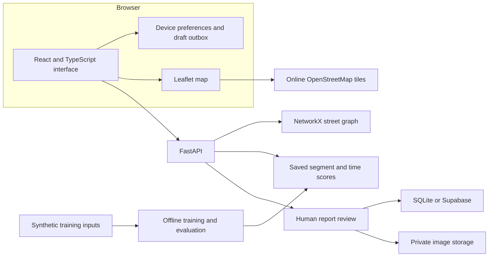

# NaviSafe

**Context for your walk. Clearer choices for your journey.**

NaviSafe is an academic research prototype that combines walking-route comparison, time-dependent street context, and human-reviewed community observations. It demonstrates how a traveller can compare more than distance while keeping the limits of the available evidence visible.

The study network covers **Dwarka, New Delhi**. The application uses React and TypeScript, a FastAPI backend, NetworkX routing, and a saved LightGBM experiment.

> **Read this first:** street geometry is derived from OpenStreetMap, but the contextual features and model-training observations are synthetic. Scores describe an experimental scenario, not a validated probability of crime or harm. A lower index, an approved report, or the absence of reports never guarantees personal safety.

[Quick start](#quick-start) · [Features](#features-and-project-status) · [Routing](#how-routing-works) · [Data and model](#data-and-model) · [Report review](#reporting-and-moderation) · [Troubleshooting](#troubleshooting)

## Why NaviSafe exists

The shortest walking route is not always the route a person prefers. Lighting, isolation, street activity, familiarity, and time of day can influence that choice. NaviSafe makes those trade-offs explorable through a small, explicitly labelled research scenario.

The project has two separate responsibilities:

1. **Route comparison:** use a street graph and saved synthetic context scores to compare walking options.
2. **Community evidence:** collect observations, protect supporting images, and record human moderation decisions.

Uploading a report does not immediately change the model, modify a route score, or establish that an incident occurred.

## Contents

- [Features and project status](#features-and-project-status)
- [Architecture](#architecture)
- [Quick start](#quick-start)
- [Suggested demonstration](#suggested-demonstration)
- [How routing works](#how-routing-works)
- [Data and model](#data-and-model)
- [Reporting and moderation](#reporting-and-moderation)
- [Storage, privacy, and authentication](#storage-privacy-and-authentication)
- [Configuration](#configuration)
- [API overview](#api-overview)
- [Testing and build](#testing-and-build)
- [Deployment](#deployment)
- [Repository guide](#repository-guide)
- [Troubleshooting](#troubleshooting)
- [Limitations and future work](#limitations-and-future-work)
- [Contributing and attribution](#contributing-and-attribution)

## Features and project status

| Area | Prototype capability | Practical limit |
| --- | --- | --- |
| Route planning | Compare Fastest, Balanced, and a route with higher contextual weighting | Limited to the available Dwarka street network |
| Street analysis | Explore the index as the scenario hour changes | Synthetic estimates, not live street measurements |
| Active journey | Foreground location, route-deviation checks, and arrival feedback | GPS accuracy and background execution depend on the browser |
| Saved routes | Keep endpoints and reopen a journey | Estimates must be recalculated |
| Community reports | Submit an observation with optional location and photo evidence | Submission starts unverified and requires human review |
| Moderation | Key-protected queue, private images, evidence states, and recorded decisions | A shared key does not identify individual staff members |
| Corrections and appeals | Request a review of an existing observation | A request does not automatically change its evidence status |
| Personal check-ins | Set an ETA, extend a reminder, confirm arrival, and view local history | No automatic contact delivery or server emergency monitoring |
| Trusted contacts | Keep contacts on the device and open manual contact actions | Opening a dialer or share sheet does not confirm delivery |
| Offline support | Cache the installed app shell and retain local data and image drafts | New routes and uncached map tiles need connectivity |
| Accounts | Optional Supabase email and Google authentication integration | Providers, redirects, and email delivery need configuration |

Some legacy identifiers and interface labels use the earlier name **SafePath**. The project is NaviSafe; existing `SAFEPATH_` environment variables and device-storage keys are retained for compatibility.

## Architecture



| Layer | Implementation |
| --- | --- |
| Frontend | React, TypeScript, Vite, React Router |
| Interface and maps | Lucide icons, Leaflet, React Leaflet |
| API and validation | Python, FastAPI, Pydantic, Uvicorn |
| Graph routing | NetworkX shortest-path search |
| Data preparation | pandas, NumPy, pyproj |
| Model comparison | scikit-learn baselines and LightGBM |
| Image processing | Pillow, image hashes, image-quality signals |
| Local persistence | SQLite, browser local storage, IndexedDB |
| Optional cloud services | Supabase Auth, Postgres, private Storage |
| Deployment entry point | Vercel configuration and `api/index.py` |

Training happens offline. The API loads a saved score table rather than fitting a model for each route request.

## Quick start

### Requirements

- **Python 3.12** with `pip`.
- **Node.js 22.12 or later** with `npm`.
- Git and internet access for installing dependencies and loading online map tiles.

Project folders are directly inside the repository root. There is no extra application directory to enter after cloning.

### Windows PowerShell

**1. Clone and install the backend dependencies**

```powershell
git clone https://github.com/aryanxaman/NaviSafe.git
cd NaviSafe
py -3.12 -m venv .venv
.\.venv\Scripts\python.exe -m pip install -r requirements.txt
```

Using the virtual environment's Python directly avoids depending on PowerShell activation settings.

**2. Start a local-only API**

In the repository root:

```powershell
$env:SUPABASE_URL = $null
$env:SUPABASE_ANON_KEY = $null
$env:SUPABASE_SERVICE_ROLE_KEY = $null
$env:SAFEPATH_MODERATOR_TOKEN = 'replace-with-a-long-random-local-key'
.\.venv\Scripts\python.exe -m backend.main
```

Replace the example moderator key with your own value. These assignments apply to this terminal; they do not edit saved environment files. Keep the terminal open.

| Address | Purpose |
| --- | --- |
| `http://127.0.0.1:8000` | Default API origin |
| `http://127.0.0.1:8000/api/health` | Status and synthetic-data provenance |
| `http://127.0.0.1:8000/docs` | Interactive API documentation |

**3. Start the frontend**

In a second terminal, starting from the repository root:

```powershell
cd frontend
npm ci
npm run dev
```

Open the address printed by Vite, usually `http://127.0.0.1:5173`. Its development proxy forwards `/api` to port `8000`.

If NaviSafe is already running on another local port, use the address printed by that process. Two previews should not compete for the same port.

### macOS and Linux

```bash
git clone https://github.com/aryanxaman/NaviSafe.git
cd NaviSafe
python3.12 -m venv .venv
.venv/bin/python -m pip install -r requirements.txt
unset SUPABASE_URL SUPABASE_ANON_KEY SUPABASE_SERVICE_ROLE_KEY
export SAFEPATH_MODERATOR_TOKEN='replace-with-a-long-random-local-key'
.venv/bin/python -m backend.main
```

Use the same frontend commands in a second terminal.

### Does the demo need Supabase or retraining?

No. Local report storage uses SQLite when `SUPABASE_URL` is unset. The repository includes the street-feature input and the saved score table, so route demonstrations do not require a new training run.

Accounts require a configured authentication service. Local route mode does not supply email delivery or Google authentication.

## Suggested demonstration

1. Open Home and review the available tools and synthetic-data notice.
2. Open Navigate and choose points inside the study network. Example coordinates are `28.583, 77.038` and `28.602, 77.054`.
3. Compare distance and contextual index across the three preferences.
4. Change the hour, recalculate, and explain changes in index or route geometry.
5. Open Analysis to inspect the street context and data-source explanation.
6. Submit a clearly labelled demonstration report, optionally attaching a non-sensitive test image. Choose publication consent deliberately.
7. Visit `/#/moderation`, enter the API's moderator key, inspect the evidence, and record a reasoned decision.
8. Review the resulting label and explain why provisional publication differs from verification.
9. Demonstrate a check-in and manual Get help options without placing a real emergency call.

Use local-only configuration for demonstration submissions rather than adding sample observations to a real community feed.

## How routing works

### Three preferences

Each graph edge has a length and an experimental context score:

```text
edge cost = length in metres × (1 + context weight × context score)
route cost = sum of its edge costs
```

| Preference | Context weight | Interpretation |
| --- | --- | --- |
| Fastest | `0` | Minimise graph distance |
| Balanced | Half the selected weight | Give context some influence alongside distance |
| Higher contextual preference | Full selected weight | Give the experimental score more influence |

The selected weight ranges from `0` to `8`. Names such as Safest or NaviSafe describe the experimental preference; they do not certify a safe route.

This context weight is a user-selected routing preference, not a learned model weight or feature importance. Adjusting it changes route selection without retraining LightGBM.

The route index is the **length-weighted mean** of segment scores, displayed on a 0–100 scale. It is not the percentage chance of harm. Walking-time estimates assume **75 metres per minute**; they are not live traffic or pedestrian-progress measurements.

### Detour limit and shared routes

The default detour limit is **1.5 times** the shortest-route length. If a weighted candidate exceeds that limit, the implementation falls back to the shortest route. It does not search every possible route for the best alternative under the cap.

Options can share a path when the shortest route also has the lowest weighted cost, the graph offers few alternatives, the preference is too small to change the optimum, or the weighted candidate exceeds the detour cap.

Returning the same geometry is valid. Different preferences do not guarantee different paths.

### What changes when the hour changes?

The saved table contains six four-hour buckets: **00–03, 04–07, 08–11, 12–15, 16–19, and 20–23**. The API interpolates between adjacent bucket scores:

```text
bucket = hour // 4
fraction = (hour % 4) / 4
score = current bucket score + fraction × (next bucket score − current bucket score)
```

For example, 10:00 is halfway between the scores associated with the 08:00 and 12:00 buckets. The final bucket wraps to midnight.

Changing time updates the scenario score and can change the preferred path. It does not collect new lighting measurements, update the map, or retrain the model. Night-time scores do not have to increase on every street. A documented rule-based fallback is used if the saved table is unavailable.

## Data and model

### Provenance and active inputs

| Input | Size | Role |
| --- | --- | --- |
| `synthetic_data/edges_features.csv` | 3,769 street-feature records | OSM-derived segment geometry and synthetic context |
| `synthetic_data/safecity_synthetic.csv` | 6,120 generated observations | One source-inspired training format |
| `synthetic_data/app_microreports_synthetic.csv` | 2,500 generated observations | Generated app-style training observations |
| `models/delhi-v3-final/risk_table.csv` | Segment and time-bucket scores | Runtime contextual lookup table |

The two observation sources contain **8,620 records**, with **8,540 retained** after the saved experiment's deduplication and geographic matching.

These are **not official datasets downloaded from Safecity, Safetipin, or NCRB**. Those names describe generated, source-inspired formats. Other generated files, legacy user-report examples, and `data/scenarios-v2/` are not all inputs to the active trainer.

Facility distances, lighting, isolation, and activity proxies are not independently verified street conditions. `ground_truth_edge_risk.csv` is a diagnostic generator output excluded from model training.

### Prediction target and features

The model predicts whether a **street segment and four-hour bucket will receive at least one synthetic observation during the following 30 days**. Reports can include positive context as well as concerns. The target is reported occurrence, not actual crime, injury, or individual safety.

The explicit feature allowlist contains 12 inputs:

| Group | Features |
| --- | --- |
| Segment | `length_m` |
| Synthetic street context | `lit`, `isolated`, `shops_open_night` |
| Synthetic nearby facilities | `dist_metro_m`, `dist_police_m`, `liquor_near`, `police_near` |
| Synthetic activity | `footfall_day`, `footfall_night` |
| Time and prior observations | `bucket`, `prior_90d_count` |

### Training and evaluation pipeline

1. Read street features and compatible generated report sources.
2. Deduplicate observations and project coordinates to **UTM Zone 43N, EPSG:32643**.
3. Match reports to the nearest straight street segment, retaining matches within **150 metres**.
4. Build dated segment/bucket snapshots. Prior counts use the preceding 90 days; labels use the following 30 days.
5. Separate chronological label windows and geographic blocks. The same location groups do not cross evaluation partitions.
6. Fit missing-value imputation and scaling on training data only.
7. Compare a constant-prevalence baseline, balanced logistic regression, and balanced LightGBM. Class weighting applies to training, not validation or test sampling.
8. Select the model by validation average precision and choose a classification threshold using validation F2.
9. Evaluate held-out test examples and save the model, splits, metrics, and runtime score table.

The saved trainer configures LightGBM with 160 estimators, learning rate `0.05`, maximum depth `5`, up to `20` leaves, minimum child samples `50`, balanced class weights, and training seed `42`. These settings define the implemented comparison, not an exhaustive hyperparameter search.

| Partition | Saved examples |
| --- | ---: |
| Training | 114,528 |
| Validation | 4,512 |
| Test | 12,084 |
| Total | 131,124 |

These are constructed segment/time/snapshot examples, not 131,124 independently collected incident reports.

### Saved experiment results

The selected model is **LightGBM**, version `delhi-v3`. Values below come from the checked-in [evaluation file](models/delhi-v3-final/evaluation.json).

| Model | Average precision | ROC-AUC | Precision | Recall | F1 | Brier score |
| --- | ---: | ---: | ---: | ---: | ---: | ---: |
| Prevalence baseline | 0.0631 | 0.5000 | 0.0631 | 1.0000 | 0.1186 | 0.0616 |
| Logistic regression | 0.1520 | 0.7230 | 0.1772 | 0.2756 | 0.2157 | 0.2410 |
| LightGBM | 0.1918 | 0.7638 | 0.1851 | 0.4934 | 0.2692 | 0.1881 |

Higher average precision and ROC-AUC indicate better ranking in this synthetic experiment. Lower Brier score is better; the baseline's lower Brier score shows that ranking gains do not establish good probability calibration. Precision and recall use each model's validation-selected threshold.

These results are not real-world safety accuracy and must not be presented as a percentage of safe journeys.

### Model files and reproduction

| File | Purpose |
| --- | --- |
| [backend/train_model.py](backend/train_model.py) | Preparation, model comparison, evaluation, and artifact generation |
| [backend/inference.py](backend/inference.py) | Inference using a trusted saved model |
| [scripts/datagenerator.py](scripts/datagenerator.py) | Synthetic-data generation utilities |
| [Model card](models/delhi-v3-final/MODEL_CARD.md) | Intended use, limitations, and methodology |
| [Model manifest](models/delhi-v3-final/manifest.json) | Input hashes, feature allowlist, seed, and provenance |
| [Saved splits](models/delhi-v3-final/splits.csv) | Evaluation membership |

To run a separate experiment from the repository root:

```powershell
.\.venv\Scripts\python.exe -m backend.train_model --data synthetic_data --out models/local-experiment
```

Choose a new output directory. The trainer refuses to overwrite a non-empty experiment directory. Retraining does not automatically replace the application model or deploy its output.

The manifest records input hashes and the training seed. The original scenario-generation seed and retrieval timestamp were not fully recorded, so reproducing training from the supplied inputs is different from reconstructing their entire generation history.

## Reporting and moderation

### Submission workflow

A report includes a street or area, category, observation time, description, and consent choices. Photos and approximate coordinates are optional. Successful submission begins at `pending_review`.

The backend checks field lengths, categories, coordinate pairing, location consent, and observation time. Stable submission keys support retries without silently creating another report. Reusing a key with different content produces a conflict.

The default freshness window is **72 hours from observation time**. Expiry means the observation is stale; it does not establish that the condition ended.

### Photo and duplication checks

The implementation:

- Enforces an **8 MB** upload limit and accepts supported JPEG, PNG, and WebP formats.
- Decodes and re-encodes images, removing original image metadata from the stored image.
- Records signals such as darkness, low detail, or low resolution.
- Calculates exact and perceptual hashes to identify duplicate candidates.
- Protects image access through the moderator endpoint instead of publishing a static image URL.

Low quality or repetition is a review signal, not proof of a false report. Capture metadata is untrusted. Automated authenticity assessment, face/plate redaction, and malware scanning are not configured as independent services.

### Evidence labels

| State | Meaning |
| --- | --- |
| `pending_review` | Submitted and awaiting a human decision |
| `provisionally_published` | Allowed to appear under publication rules; still unverified |
| `corroborated` | Supporting candidates and their independence have been reviewed |
| `verified` | Corroboration and the required evidence/privacy review have been documented |
| `disputed` | A reviewer recorded conflicting evidence |
| `rejected` | A reviewer declined the submission with a reason |
| `expired` | The configured freshness window elapsed |

Corroborated and verified transitions require **at least two additional distinct supporting candidates** and a reviewer's confirmation of independence. Verified status also requires the documented evidence and privacy review. Matching candidates does not prove that separate devices represent separate people.

A declined report does not automatically mean its author lied. Privacy, duplication, insufficient evidence, and factual inconsistencies can all affect a decision.

### Moderator access and audit records

Open `/#/moderation` and enter `SAFEPATH_MODERATOR_TOKEN`. The backend compares the bearer credential with the server-side token. No separate admin account is required.

Review changes record a reason, reviewer reference, timestamp, and version. The local review path checks report versions to detect conflicting decisions. A shared key suits a controlled demonstration, not strong individual staff accountability.

Verified reports with the required consent can be explicitly curated through protected training-curation endpoints. Curation is separate from publication and does not automatically retrain or replace the model. Real-world reuse would require appropriate data permissions and independent evaluation.

## Storage, privacy, and authentication

| Data | Default handling |
| --- | --- |
| Preferences, contacts, saved endpoints, check-in history | Browser storage on the current device |
| Draft fields and image blobs | Local IndexedDB outbox until submitted |
| Submitted reports in local-only mode | SQLite at `data/safepath.sqlite3` |
| Local evidence images | `data/private_media/`, accessible through protected API access |
| Cloud reports | Supabase Postgres when configured |
| Cloud images | Private Supabase Storage bucket, default `report-media` |

Local device identifiers are pseudonyms, not verified personal identities. With the complete Supabase authentication configuration, the API checks bearer sessions against Supabase.

Location is requested when the user chooses a location-dependent action. Foreground tracking is not a continuous emergency service. Browser-local data does not automatically appear on another device or localhost port.

Private environment files must remain outside Git. Public Supabase client keys may be used by the frontend; service-role and moderator keys must remain server-only.

## Configuration

### Variables

| Variable | Side | Default or purpose |
| --- | --- | --- |
| `VITE_SUPABASE_URL` | Frontend | Optional Supabase project URL |
| `VITE_SUPABASE_ANON_KEY` | Frontend | Public client key for accounts |
| `VITE_API_URL` | Frontend | API base path; normally `/api` |
| `SUPABASE_URL` | Backend | Enables cloud report persistence |
| `SUPABASE_ANON_KEY` | Backend | Public project key used for session verification |
| `SUPABASE_SERVICE_ROLE_KEY` | Backend only | Protected database and storage access |
| `SUPABASE_MEDIA_BUCKET` | Backend | Defaults to `report-media` |
| `SAFEPATH_MODERATOR_TOKEN` | Backend only | Moderation and private evidence access |
| `SAFEPATH_PORT` | Backend | Defaults to `8000` |
| `SAFEPATH_DB` | Backend | Override the SQLite path |
| `SAFEPATH_MEDIA` | Backend | Override the private-media directory |
| `SAFEPATH_RISK_TABLE` | Backend | Defaults to `models/delhi-v3-final/risk_table.csv` |
| `SAFEPATH_REPORT_TTL_HOURS` | Backend | Defaults to `72` |
| `SAFEPATH_ORIGINS` | Backend | Comma-separated allowlist for direct cross-origin clients |

Vite reads frontend settings from `frontend/.env.local`. Python reads its **process environment**; a root `.env` file is not automatically loaded by `python -m backend.main`.

A frontend configuration template is:

```dotenv
VITE_SUPABASE_URL=https://your-project.supabase.co
VITE_SUPABASE_ANON_KEY=your-public-client-key
VITE_API_URL=/api
```

Replace these placeholders with your project values. Never create a `VITE_SUPABASE_SERVICE_ROLE_KEY` or expose a moderator token through a `VITE_` variable. Restart Vite after changing build-time variables.

### Optional Supabase setup

Cloud operation requires more than filling in a URL:

1. Prepare database tables and policies, using [supabase/schema.sql](supabase/schema.sql) as a starting point.
2. Review schema compatibility before applying it. In the committed schema, `reports.id` is text while `report_reviews.report_id` is declared as UUID; that relationship needs a compatible migration before cloud review storage can be used.
3. Configure a private media bucket and the backend URL, public key, and service-role key together.
4. Configure the frontend public URL/key pair.
5. Set the authentication Site URL and permitted redirects for the actual deployment.
6. Configure email confirmation and delivery. Google sign-in additionally requires its OAuth provider configuration.
7. Verify sign-up, confirmation, sign-in, protected reports, and private image access end to end.

When `SUPABASE_URL` is set, incomplete cloud configuration does not silently fall back to SQLite. Use local-only mode for a fresh demonstration until cloud setup is complete and checked.

## API overview

Interactive schemas at `/docs` provide detailed field definitions.

| Method | Endpoint | Purpose | Access |
| --- | --- | --- | --- |
| GET | `/api/health` | Availability, provenance, and capability flags | Public |
| GET | `/api/graph?hour=20` | Street graph with scenario scores | Public |
| POST | `/api/route` | Compare three route preferences | Public |
| POST | `/api/report` | Submit an observation and optional image | Local device or configured account |
| GET | `/api/reports` | Reports filtered by visibility rules | Local device or configured account |
| GET | `/api/reports?mine=true` | The submitter's reports | Submitting identity |
| POST | `/api/reports/{id}/review` | Request a correction, appeal, or review | Authorised reporting identity |
| GET | `/api/moderation` | Moderator queue | Moderator key |
| GET | `/api/moderation/{id}/image` | Private evidence image | Moderator key |
| POST | `/api/moderation/{id}` | Record an evidence-state decision | Moderator key |
| POST | `/api/moderation/{id}/training` | Explicit training-curation decision | Moderator key |
| GET | `/api/moderation/training-dataset` | Export eligible curated examples | Moderator key |

### Example route request

With the API running on its default port:

```powershell
$body = @{
    start_lat = 28.583
    start_lon = 77.038
    end_lat = 28.602
    end_lon = 77.054
    hour = 20
    alpha = 2
    detour_cap = 1.5
} | ConvertTo-Json

Invoke-RestMethod -Method Post `
    -Uri 'http://127.0.0.1:8000/api/route' `
    -ContentType 'application/json' `
    -Body $body
```

Responses include geometry, distance, contextual exposure, generation time, and provenance. `422` indicates invalid input or an unavailable route, `401` an account-authentication issue, `403` insufficient moderator access, and `409` a conflicting update or submission key.

## Testing and build

Use an isolated local environment with Supabase credentials unset. Backend tests use temporary local storage; production service configuration should not be inherited into a test run.

From the repository root:

```powershell
$env:SUPABASE_URL = $null
$env:SUPABASE_ANON_KEY = $null
$env:SUPABASE_SERVICE_ROLE_KEY = $null
.\.venv\Scripts\python.exe -m unittest discover -s tests -v
```

From `frontend/`:

```powershell
node --test
npm run lint
npm run build
```

| Check | What it verifies |
| --- | --- |
| Evidence processing | Invalid images, metadata removal, duplicates, and evidence-state gates |
| Report API | Idempotency, consent, access control, review conflicts, expiry, and curation |
| Model pipeline | Feature restrictions, saved artifact contracts, and evaluation separation |
| Browser-side logic | Check-in deadlines, offline drafts, service-worker exclusions, and manifest assets |
| Frontend build | TypeScript compilation and production asset generation |

A passing suite is software verification, not field validation. SMTP delivery, real Google OAuth, deployed policies, and outcomes for pedestrians need separate acceptance checks. Test counts depend on the revision; use actual command output when presenting results.

## Deployment

See [VERCEL_DEPLOY.md](VERCEL_DEPLOY.md) and [vercel.json](vercel.json). The intended layout is:

| Setting | Value |
| --- | --- |
| Project Root Directory | Repository root, `.` |
| Frontend installation | `npm ci --prefix frontend` |
| Frontend build | `npm run build --prefix frontend` |
| Static output | `frontend/dist` |
| Python entry point | `api/index.py` |

Do not configure an additional inner `NaviSafe` root directory. Keep the street-feature CSV and active score table available to the Python function. Configure secrets in the hosting environment, not in source files or the browser bundle.

Cloud deployments need durable report and media storage rather than a serverless function's filesystem. Validate the provider's Python runtime settings, build configuration, authentication redirects, and report schema. A successful Git push or frontend build alone does not establish that the deployed API and accounts work.

## Repository guide

```text
NaviSafe/
├── api/                 Hosting entry point for FastAPI
├── backend/             API, evidence rules, persistence, training, and inference
├── backups/             Historical project backup
├── data/                Additional scenarios and local runtime data
├── deploy/              Additional hosting configuration
├── frontend/            React application, PWA assets, and frontend tests
│   ├── public/          Icons, manifest, and service-worker template
│   ├── src/             Components, screens, and client-side logic
│   └── tests/           Browser-side logic tests
├── models/              Models, scores, splits, and evaluation metadata
│   └── delhi-v3-final/  Active saved experiment and runtime scores
├── reports/             Data audits and implementation notes
├── scripts/             Synthetic-data generation and audit utilities
├── supabase/            Database schema
├── synthetic_data/      Active generated inputs and cached study network
├── tests/               Python verification tests
├── .env.example
├── .gitignore
├── PROJECT.md
├── README.md
├── requirements.txt
└── vercel.json
```

### Where to start reading the code

| Question | Starting point |
| --- | --- |
| How are routes scored? | [backend/main.py](backend/main.py) |
| How are images checked and evidence states enforced? | [backend/evidence.py](backend/evidence.py) |
| How are local reports stored? | [backend/store.py](backend/store.py) |
| How is cloud persistence accessed? | [backend/supabase_store.py](backend/supabase_store.py) |
| How is the model trained? | [backend/train_model.py](backend/train_model.py) |
| How is the route interface built? | [frontend/src/pages/MapPage.tsx](frontend/src/pages/MapPage.tsx) |
| How does moderator access work? | [frontend/src/pages/ModerationPage.tsx](frontend/src/pages/ModerationPage.tsx) |
| How are drafts submitted and retried? | [frontend/src/services.ts](frontend/src/services.ts) |
| How are checks organised? | [tests/](tests/) and [frontend/tests/](frontend/tests/) |

[PROJECT.md](PROJECT.md) is the original research brief. Proposed architectures and future capabilities are not completed integrations. The source, saved experiment artifacts, and current test results establish implemented behaviour.

## Troubleshooting

| Symptom | What to check |
| --- | --- |
| The page opens but routes do not load | Check that the API runs, `/api/health` responds, and the proxy targets the API port |
| A selected point is rejected | Choose points on the study network; the API rejects points more than roughly 400 m from the nearest graph node |
| All route options look identical | Check context weight, graph connectivity, and detour fallback; identical routes can be correct |
| Moderation is locked | Set `SAFEPATH_MODERATOR_TOKEN` in the API process, restart it, and enter that exact key |
| Sign-in or confirmation fails | Check the provider, email delivery, Site URL, and redirects; local route mode has no email service |
| Reports fail after adding a Supabase URL | Complete the keys, schema, bucket, and authentication configuration, or return to local-only mode |
| `.env` changes appear ineffective | The API does not automatically load the root file; Vite needs its frontend variables and a restart |
| Contacts or drafts are missing on another device | Browser-local data is not automatically synchronised across devices or origins |
| Model output directory is rejected | Choose a new empty experiment path |
| Notifications or location updates stop | Browser background limits apply; keep manual contact options available |
| Vercel fails after folder reorganisation | Check its Root Directory and the install/build commands relative to that root |

## Limitations and future work

### Current limitations

- **Coverage:** a small Dwarka network, not all of Delhi or unrestricted navigation.
- **Evidence:** generated context and observations, reporting bias, and no independent real-world outcome validation.
- **Geometry:** straight segments and an undirected graph simplify actual walking constraints.
- **Calibration:** ranking scores are not calibrated probabilities of personal harm.
- **Review:** photos and automated signals cannot establish truth; shared keys limit staff accountability.
- **Delivery:** no guaranteed background tracking, automatic SMS/calls, or confirmed emergency response.
- **Accessibility:** preferences do not constitute verified wheelchair-accessible routing.
- **Operations:** cloud schema, authentication, delivery, and policies require deployment-specific verification.

### Research and product directions

Obtain permitted real observations with clear labels; independently audit predictions; evaluate accessibility and detour trade-offs; run moderated usability studies; and measure review agreement, false positives, and failure recovery. Individual moderator identities and production concurrency protections are further operational work.

Future real-data training needs appropriate consent, separate evaluation, and an explicit release decision. Unreviewed uploads should not become automatic model labels.

## Contributing and attribution

For a useful contribution:

1. Describe the behaviour or research question and affected screen or API.
2. Keep generated, observed, and user-submitted data clearly distinguished.
3. Add meaningful checks for changed behaviour and run relevant tests and builds.
4. Keep credentials, private images, personal identifiers, and runtime databases out of commits.
5. Document changes to provenance, evaluation assumptions, and evidence rules.

Street geometry and map tiles are attributed to [OpenStreetMap contributors](https://www.openstreetmap.org/copyright). Dependencies retain their respective licences. A project-wide `LICENSE` file has not yet been provided; no additional software licence is implied by this README.
