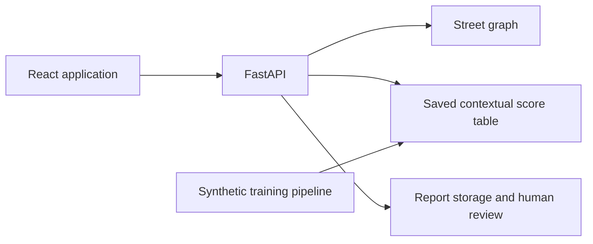

# NaviSafe

**Context for your walk. Clearer choices for your journey.**

NaviSafe is a research prototype for comparing walking routes, exploring time-dependent street context, and sharing community observations through human review. The study area is a small OpenStreetMap-derived network in **Dwarka, New Delhi**.

> **Research demonstration:** street geometry is derived from OpenStreetMap, while the contextual features and model-training reports are synthetic. A lower contextual index is not proof that a street is safe. NaviSafe is not an emergency monitoring service.

## Features

- **Route comparison:** compare distance-first, balanced, and context-weighted walking routes, with a limit on extra distance.
- **Time-aware analysis:** change the scenario hour to explore how the experimental street index and route preferences change.
- **Community observations:** submit descriptions and optional photos, give publication consent, and follow evidence labels and review requests.
- **Moderator workspace:** review evidence using a protected moderator key. A regular user account does not grant moderator access.
- **Journey tools:** save route endpoints, maintain trusted contacts, and set personal arrival check-ins.
- **Local storage and offline support:** retain supported app-shell content, preferences, and report drafts on the device. New route calculations and map tiles require a connection.
- **Optional authentication:** Supabase email and Google sign-in, when the corresponding providers and redirects are configured.

Check-ins do not automatically call or message anyone. Photo checks support human review; they do not establish that an observation is true. Submitted community reports do not automatically become model-training data or change route scores.

## Technology

| Layer | Tools |
| --- | --- |
| Web application | React, TypeScript, Vite |
| Maps | Leaflet, React Leaflet, OpenStreetMap |
| API | Python, FastAPI, Uvicorn |
| Routing | NetworkX |
| Modelling | LightGBM, scikit-learn, pandas, NumPy |
| Storage | SQLite for local operation; optional Supabase database and private media storage |
| Deployment | Vercel frontend and Python API configuration |



## Run locally

### Prerequisites

- Python **3.12** with `pip`.
- Node.js **22.12 or later** with `npm`.
- Git and an internet connection for installing dependencies and loading online map tiles.

The commands below use Windows PowerShell. Run them from the repository root, where `backend/`, `frontend/`, and `requirements.txt` are located directly.

### 1. Clone and prepare Python

```powershell
git clone https://github.com/aryanxaman/NaviSafe.git
cd NaviSafe
py -3.12 -m venv .venv
```

### 2. Start the API

```powershell
.\.venv\Scripts\python.exe -m pip install -r requirements.txt
$env:SAFEPATH_MODERATOR_TOKEN = 'replace-with-a-long-random-local-key'
.\.venv\Scripts\python.exe -m backend.main
```

Replace the example moderator key with your own value. Keep this terminal open. The default API address is `http://127.0.0.1:8000`; interactive API documentation is available at `http://127.0.0.1:8000/docs`.

With `SUPABASE_URL` unset, the backend uses local SQLite storage. The supplied street features and saved score table allow route demonstrations without retraining the model.

### 3. Start the frontend

Open a second terminal in the repository root:

```powershell
cd frontend
npm ci
npm run dev
```

Open the URL printed by Vite, usually `http://127.0.0.1:5173`. The development server forwards `/api` requests to the backend on port `8000`.

To review reports, visit `/#/moderation` on the frontend and enter the key configured in the API terminal. No separate admin account is required.

## Optional Supabase configuration

Local route demonstrations do not require Supabase. Accounts, email delivery, Google sign-in, and cloud report storage require additional setup.

| Variable | Where it belongs | Purpose |
| --- | --- | --- |
| `VITE_SUPABASE_URL` | Frontend | Supabase project URL |
| `VITE_SUPABASE_ANON_KEY` | Frontend | Public client key |
| `VITE_API_URL` | Frontend | API base path; normally `/api` |
| `SUPABASE_URL` | Backend | Enables Supabase-backed operation |
| `SUPABASE_ANON_KEY` | Backend | Public project key used by the server's authentication integration |
| `SUPABASE_SERVICE_ROLE_KEY` | Backend only | Server access to protected database and storage operations |
| `SAFEPATH_MODERATOR_TOKEN` | Backend only | Moderator access key |
| `SAFEPATH_PORT` | Backend | API port; defaults to `8000` |

Vite reads frontend settings from `frontend/.env.local`. The Python API reads its process environment; placing a root `.env` file on disk does not automatically load it. Set backend values in the terminal or configure them in your hosting environment.

Run [supabase/schema.sql](supabase/schema.sql) for a new Supabase setup. Configure email delivery, Google OAuth credentials, redirect URLs, and private media storage separately. A visible sign-in button does not confirm that a provider is ready.

Keep private environment files out of Git. **Never put a service-role key or moderator key in a `VITE_` variable.** Existing `SAFEPATH_` configuration names are retained for compatibility with the earlier project name.

## Data and model

The active training inputs are in [synthetic_data/](synthetic_data/):

| File | Contents |
| --- | --- |
| `edges_features.csv` | 3,769 street-feature records; mapped geometry with synthetic contextual attributes |
| `safecity_synthetic.csv` | 6,120 generated observations in a source-inspired format |
| `app_microreports_synthetic.csv` | 2,500 generated app-style observations |

These are **not official Safecity, Safetipin, or NCRB datasets**. Additional generated examples are present in the repository but are not all inputs to the active trainer.

The selected LightGBM model estimates whether a street segment and four-hour time bucket will receive a synthetic report during the following 30 days. The backend reads saved scores from `models/delhi-v3-final/risk_table.csv` and interpolates between time buckets. Route costs combine street length with the contextual score and the chosen preference weight.

Training uses separate chronological and geographic partitions. Hidden generator truth and future-label fields are excluded from model features. Synthetic evaluation demonstrates the pipeline; it does not validate real-world safety predictions.

See the [model card](models/delhi-v3-final/MODEL_CARD.md), [evaluation results](models/delhi-v3-final/evaluation.json), and [training implementation](backend/train_model.py).

To run a separate experiment without replacing the saved application model:

```powershell
.\.venv\Scripts\python.exe -m backend.train_model --data synthetic_data --out models/local-experiment
```

## Checks and production build

From the repository root:

```powershell
.\.venv\Scripts\python.exe -m unittest discover -s tests -v
```

From `frontend/`:

```powershell
node --test
npm run lint
npm run build
```

Tests cover implemented behaviours using local fixtures and controlled service substitutes. They do not establish successful production email delivery, OAuth configuration, or field safety outcomes.

## Repository layout

```text
NaviSafe/
├── api/                 Vercel API entry point
├── backend/             API, routing, model training, and report evidence logic
├── backups/             Historical project backup
├── data/                Additional scenarios and local runtime storage
├── deploy/              Hosting configuration
├── frontend/            React application and frontend tests
├── models/              Saved models, score tables, and evaluation metadata
├── reports/             Data audits and implementation notes
├── scripts/             Dataset generation and audit utilities
├── supabase/            Database schema
├── synthetic_data/      Generated datasets and cached street network
├── tests/               Python verification tests
├── .env.example
├── .gitignore
├── PROJECT.md
├── requirements.txt
├── vercel.json
└── README.md
```

For deployment instructions, see [VERCEL_DEPLOY.md](VERCEL_DEPLOY.md). Use the **repository root** as the Vercel Root Directory, rather than an inner `NaviSafe` folder. [PROJECT.md](PROJECT.md) contains the original project brief and proposed research directions; planned capabilities should not be treated as completed integrations.

## Limitations

- Routing covers the Dwarka study network, not all of Delhi.
- Contextual features and reported-occurrence labels are synthetic and may contain modelling and reporting bias.
- Low scores, missing reports, and approval labels do not guarantee personal safety.
- Browser location, timers, and notifications can stop when the device sleeps or the browser closes.
- Online map data remains subject to its providers' availability and attribution requirements.

OpenStreetMap geometry and map tiles are credited to [OpenStreetMap contributors](https://www.openstreetmap.org/copyright).
